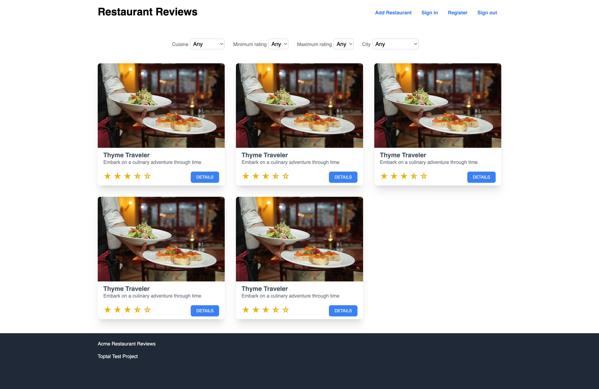

# Toptal Restaurants Frontend Boilerplate

This boilerplate is there to help you get started faster. Feel free to modify it as you wish, use it only as an inspiration, or not use it at all.

It uses `tailwind`, so any changes will need to be compiled.

```
$ npm install
$ npm run frontend:dev
```


